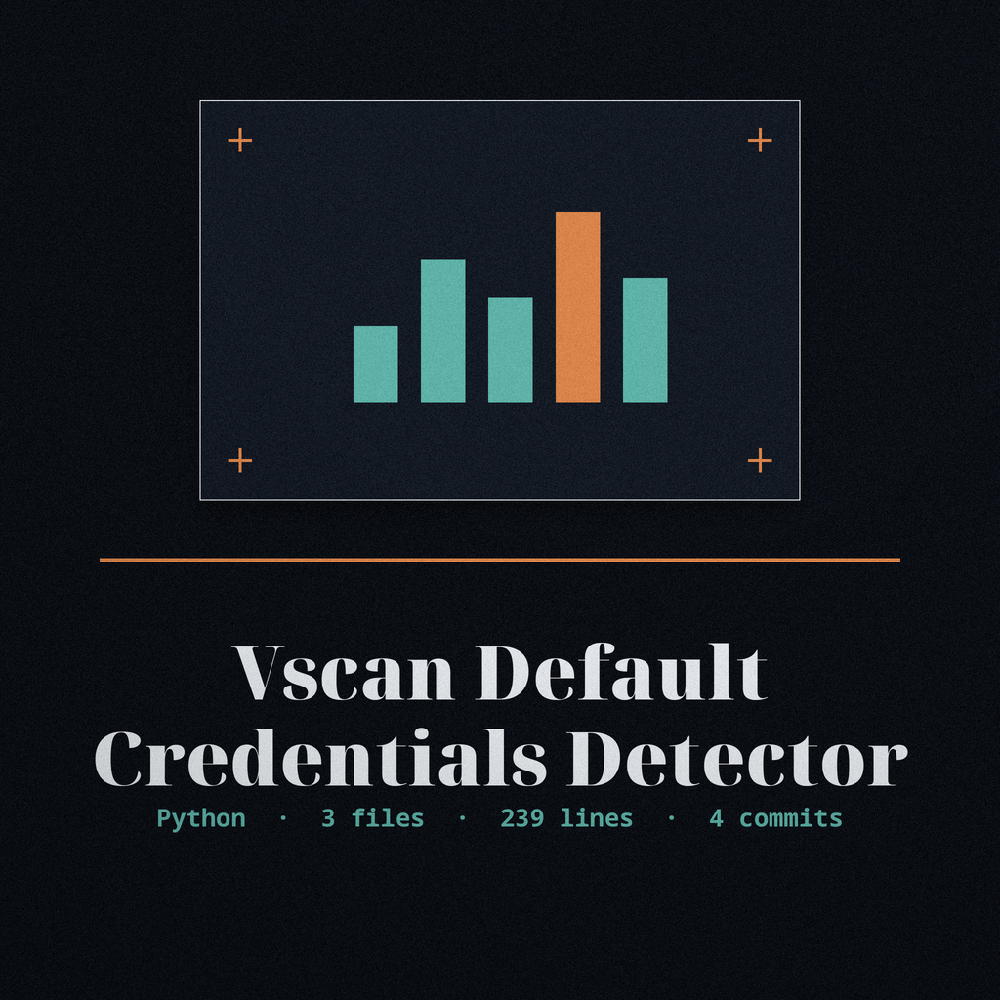
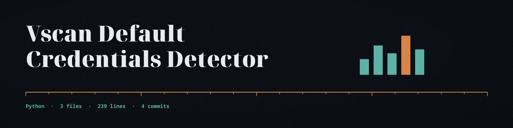

# vscan-default-credentials-detector





Tries known default username and password pairs, plus any operator supplied pairs from a JSON file, against the `/login` path of the target supplied by the operator, and reports every pair that succeeds. A custom pair for a username that also has a built-in pair does not replace the built-in pair; both are tried. A login attempt answered with HTTP 401 or 403 is recorded as a failed attempt, not a request error. Success requires a redirect response, or a response containing "Welcome" without a password login form. Passwords are never written in clear: a successful record reports the username and a fixed masked marker in place of the password, in the console output, in verbose logs, and in the saved JSON file. An invalid URL or an unreadable custom credentials file exits 1. Only use this tool against targets you are authorized to test.

## Install

```bash
git clone https://github.com/ShadowGuard-AI/vscan-default-credentials-detector
cd vscan-default-credentials-detector
pip install -r requirements.txt
```

## Usage

```bash
python3 main.py <url> [-d DATA] [-v] [-o OUTPUT]
python3 main.py http://127.0.0.1:8000/ -d pairs.json -o results.json
```

The custom credentials file is a JSON object mapping usernames to passwords, for example `{"admin": "guess1", "operator": "operator"}`.

## Parameters

- `url`: The URL of the target web application (positional, required)
- `-d`, `--data`: Path to a file containing a custom default credentials list (JSON format)
- `-v`, `--verbose`: Enable verbose output for debugging
- `-o`, `--output`: Output file to write results to (JSON format)

## License

MIT. See LICENSE.
